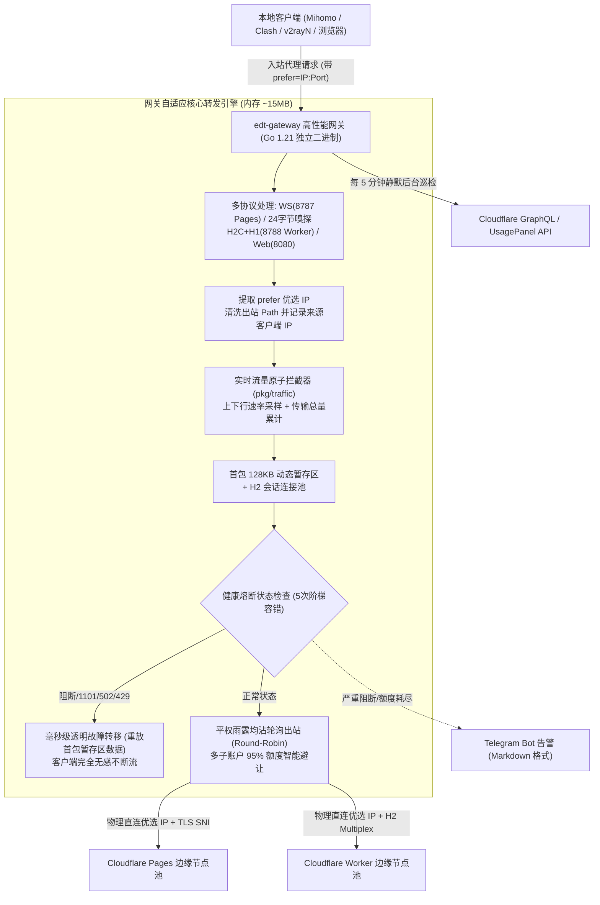

# EdgeTunnel Gateway (edt-gateway) 全生命周期开发记忆与架构备忘录

> **创建时间**：2026-10-13  
> **最后更新**：2026-10-24  
> **文档定位**：长期上下文记忆、架构演进脉络、环境与密钥备忘、历史对话全景推演、OpenWrt 部署排坑指南与协作军规。

---

## 目录
- [一、项目定位与核心命名](#一项目定位与核心命名)
- [二、协作军规与版本发布准则（核心约束）](#二协作军规与版本发布准则核心约束)
- [三、工程目录设计与多环境隔离演进](#三工程目录设计与多环境隔离演进)
- [四、本地环境与 GPG 提交签名配置](#四本地环境与-gpg-提交签名配置)
- [五、历史对话问答全景与项目演进脉络](#五历史对话问答全景与项目演进脉络)
  - [阶段一：源起排障、CF 额度监控联动与生产容器挂载](#阶段一源起排障cf-额度监控联动与生产容器挂载)
  - [阶段二：体验革命、优选机制落地与工程模块化大重构](#阶段二体验革命优选机制落地与工程模块化大重构)
  - [阶段三：并发性能突破、智能加权调度与开源发布闭环](#阶段三并发性能突破智能加权调度与开源发布闭环)
  - [阶段四：Go 原生重构、OpenWrt 系统级部署与全功能迭代 (v1.0.4 ~ v1.0.9)](#阶段四go-原生重构openwrt-系统级部署与全功能迭代-v104--v109)
- [六、OpenWrt 系统级部署与运维规范](#六openwrt-系统级部署与运维规范)
- [七、同机透明代理（Nikki / OpenClash）防死循环避坑法则](#七同机透明代理nikki--openclash防死循环避坑法则)
- [八、核心架构机制全景一览 (Mermaid)](#八核心架构机制全景一览-mermaid)
- [九、一键全自动安装命令备忘](#九一键全自动安装命令备忘)

---

## 一、项目定位与核心命名

- **项目全称**：`EdgeTunnel Gateway (edt-gateway) 本地自适应动态分流网关`
- **开源代码仓库**：`https://github.com/aihddelyy/edgetunnel-gateway`
- **技术栈演进**：
  - **初期 (Node.js 版)**：Node.js 20 LTS (Alpine 镜像)、原生 ESM、Vanilla HTML/CSS/JS（现归档于 `nodejs_version` 分支）。
  - **重构期 (Go 高性能版)**：Go 1.21 纯静态编译（`CGO_ENABLED=0`）、`//go:embed` 内嵌前端 SPA 单二进制、零外部环境依赖、RSS 内存仅 ~15MB（现为主默认分支 `go_version`）。
- **前置灵感与致谢项目**：
  - [cmliu/edgetunnel](https://github.com/cmliu/edgetunnel)：Vless/Trojan 协议与 Cloudflare 边缘隧道转发参考。
  - [cmliu/CF-Workers-UsagePanel](https://github.com/cmliu/CF-Workers-UsagePanel)：Cloudflare 官方 GraphQL API 配额拉取机制与 UI 参考。

---

## 二、协作军规与版本发布准则（核心约束）

> [!IMPORTANT]
> ### 🚨 绝对版本控制规则（不可动摇的军规）
> 1. **日常的代码开发、问题调试、局部优化或 Git 提交，必须严格保持当前版本号不变！**
> 2. **只有在用户明确下达“提升版本号 / 发布新版本 / 打 Tag 发布”的指令时，才允许修改版本号（`version.go`、`index.html`、`CHANGELOG.md`）、创建 Git Tag 并推送触发 Release 流水线！**
> 3. **部署目标机红线**：绝不能向 NAS (`\\SA6400\docker\edgetunnel-lb`) 拷贝 Go 二进制，用户的 Go 网关部署在 **OpenWrt 软路由 (10.10.10.6，Linux x86_64 / AMD64)**。

---

## 三、工程目录设计与多环境隔离演进

为了同时兼顾本地代码调试、群晖 NAS 生产运行、OpenWrt 软路由原生运行以及 GitHub 开源发布（100% 隐私脱敏），确立了以下仓库与目录结构：

| 目录/分支 | 角色与用途 | 说明 |
| :--- | :--- | :--- |
| **`go_version/`** | **Go 高性能版仓库主目录** | 独立 Git 仓库（远程为 `edgetunnel-gateway.git`），**默认主分支为 `go_version`**。单二进制交付。 |
| **根目录 `master` -> `nodejs_version`** | **Node.js 历史版本归档** | 包含原始开发目录 `dev/`、历史单文件 `v1.0/`，分支已规范更名为 `nodejs_version`。 |
| **`nas/`** | **群晖 NAS 部署镜像** | Root Git 忽略 (`nas/`)，同步到群晖私有卷 `\\SA6400\docker\edgetunnel-lb` 的历史运行目录。 |
| **`build.ps1`** | **本地自动化交叉编译脚本** | 位于 `go_version/` 根目录，同步静态前端并极速构建 AMD64 与 ARM64 二进制。 |

> **安全红线**：所有 `**/config.json`、敏感 Token、NAS 私有域名与密码**严禁**提交到开源仓库。

---

## 四、本地环境与 GPG 提交签名配置

为确保开源代码的真实性与不可伪造性，配置了本地 Git 的自动化 GPG 提交签名：

- **GPG 执行程序路径**：`D:/Tools/WinGPG-1.2-Portable-x64/x64/gpg.exe`
- **GPG 密钥 ID**：`06A63555CC2A72DC`
- **用户身份**：`aihddelyy <aihdce@gmail.com>`
- **Git 配置命令**：
  ```bash
  git config --global gpg.program "D:/Tools/WinGPG-1.2-Portable-x64/x64/gpg.exe"
  git config --global user.signingkey 06A63555CC2A72DC
  git config --global commit.gpgsign true
  ```

---

## 五、历史对话问答全景与项目演进脉络

### 阶段一：源起排障、CF 额度监控联动与生产容器挂载
1. **CF 额度监控 B 模式数据缺失 Bug 修复**：补齐 GraphQL API 解析中 Pages 与 Workers 各项指标的解构映射，修复账户下多个项目指标汇总丢失。
2. **群晖 NAS 部署与热更新机制确认**：明确本地通过 SMB 路径直连 NAS，Docker 容器卷映射实时读取目录，实现无缝热更新。
3. **UI 视觉规范升级**：全面优化 Worker 与 Pages 的专属 SVG 图标。
4. **后端池与 CF 账户关联绑定机制**：节点卡片渲染直观的额度进度条与告警状态，支持单项消耗与总计消耗切换。

---

### 阶段二：体验革命、优选机制落地与工程模块化大重构
1. **优选节点（Prefer Node）深度机制探索与纠偏**：
   - 用户纠偏：后端域名只是 Worker/Pages 的域名，实际连接是使用客户端携带的 `prefer=IP:Port` 优选 IP，测速后端域名无意义；
   - 落地实时收集客户端活跃优选节点并本地物理 TCP RTT 测速；
   - 针对双重转义端口（`%3A8443:443`）编写健壮的解码清洗逻辑。
2. **熔断标准优化与 Web 控制台交互质变**：
   - 优化为 5 次阶梯容错，区分网络抖动与致命阻断；
   - 自研页面级暗黑模态弹窗（带防误触倒计时）；Sticky Header 零位移吸顶；后台巡检 5 分钟联动。
3. **单文件架构 -> ES Modules 模块化工程大拆分**：解耦为 `lib/` 核心模块，原始母版归档于 `v1.0/`。
4. **多环境工程隔离与开源**：确立开源命名为 `edgetunnel-gateway`。

---

### 阶段三：并发性能突破、智能加权调度与开源发布闭环
1. **Web UI 日志流丢失 Bug 修复**：修复日志结构体广播解包引发的未捕获错误。
2. **HTTP/2 弹性多连接池**：解决单连接大流量多线程下载时的 TCP 队头阻塞。
3. **用户核心质疑纠偏：“EWMA 延迟加权分流是伪功能”**：
   - 深入辨析出站直连同一优选 IP 的物理网络 RTT 几乎相同；
   - 彻底废除 EWMA 延迟加权，全面回归纯粹坚挺的**平权雨露均沾轮询 (Fair Round-Robin)**，完美平摊配额。
4. **节点成功率统计机制深度“提纯”**：严格隔离物理链路超时与业务层阻断（1101/502/429），避免垃圾优选 IP 拉垮正常 Worker 的成功率。
5. **优选 IP 物理故障交由客户端（Mihomo）快速切流**：超时直接快速断开让上游策略组秒级切流，业务层阻断由网关利用 128KB 首包暂存无感故障转移。
6. **全方位内存治理 (Memory Guard)**：首包暂存释放、背压流控、V8 原生 GC 触发与守护巡检。
7. **全站时间人性化分级展示**：`formatDuration`（分/小时/天多级折算）。
8. **流媒体与 YouTube 专项加速**：废除无效会话粘性，H2 窗口拉大至 6MB/16MB，全链路启用 `TCP_NODELAY`。
9. **GitHub 官方 Wiki 构建**：7 大核心专题完整发布上线。

---

### 阶段四：Go 原生重构、OpenWrt 系统级部署与全功能迭代 (v1.0.4 ~ v1.0.9)

为追求极致低内存（<20MB）、零环境依赖单文件交付，并原生适配 OpenWrt 软路由环境，项目使用 Go 语言进行了全面重构，并经历了多轮关键迭代：

#### 1. v1.0.4：在线更新实时流光进度条与多层弹窗优化
- 修复系统版本与在线更新弹窗 z-index 层叠遮挡问题。
- 后端下载器接入流式计数中间件，提供免鉴权进度查询接口 `GET /api/update/progress`，Web 控制台新增渐变流光进度条与实时网速（如 `2.8 MB/s`）显示。

#### 2. v1.0.5：Linux / OpenWrt 进程平滑自重启深度修复
- **避免读取带 ` (deleted)` 的失效路径**：Linux 下旧程序被覆盖后 `/proc/self/exe` 被 unlink，改为显式传入已替换的新程序绝对路径并去后缀。
- **重构子进程派生模型**：弃用嵌套子 Shell，改用独立 Session 进程 `sleep 2; cd '<dir>'; exec '<exe>' <args> >> app.log 2>&1` 平滑拉起。

#### 3. v1.0.6：产物全面更名 edt-gateway 与双向平滑兼容
- 发布二进制产物全面更名为 `edt-gateway-linux-amd64` 与 `edt-gateway-linux-arm64`。
- 更新引擎双向兼容 `edt-gateway-*` 与历史 `edgetunnel-lb-*`，实现跨版本零感知平滑自动更新。

#### 4. v1.0.7：优选服务器请求量计数与活跃客户端感知
- `PreferNode` 模型补齐 `requestCount` 与 `clients` 字段，彻底解决前端始终显示 0 次的缺陷。
- `ws.go` 与 `xhttp.go` 入站时精准抓取真实客户端 IP，去重记录到最近活跃设备列表。
- 彻底解耦业务请求与节点健康测速（`RecordPing`），杜绝测速行为虚增业务请求计数。

#### 5. v1.0.8：实时上下行速率与累计数据总量看板 (方案 B)
- 引入核心模块 `pkg/traffic/traffic.go`，通过 `sync/atomic` 实现 `TotalRxBytes` 与 `TotalTxBytes` 零损耗原子计数。
- 后台 1 秒滑动窗口平滑采样引擎，计算瞬时下行带宽和上行带宽（Bps）。
- 全链路在 `ws.go` 和 `xhttp.go` 管道挂载 `CountingWriter`。
- 控制台首页扩展为并排 6 列指标卡片（新增“🔻 实时下载速率”与“🔺 实时上传速率”卡片，带“传输中”高亮微标，轮询频率调至 2 秒）。

#### 6. v1.0.9：活跃优选服务器实施规则 A 稳定排序
- 解决卡片列表因 Go map 随机散列导致的前端卡片跳动问题。
- 实施**规则 A 稳定排序**：
  1. **🌟 默认兜底服务器始终固定置顶（排在第 1 位）**；
  2. **其余节点严格按照业务请求量（`requestCount`）从大到小降序排列**；
  3. **请求量相同时按目标节点域名/IP 字典序保底**。
- 后端（`sort.SliceStable`）与前端（`renderPreferNodes`）双重排序保障。

#### 7. 仓库主分支规范化调整
- 将 GitHub 仓库 `aihddelyy/edgetunnel-gateway` 的**默认主分支（Default Branch）切换为 `go_version`**。
- 原 `master` 分支规范化更名为 **`nodejs_version`**，旧 `master` 分支安全删除。
- 确认自动更新机制依赖 GitHub Releases / Tag，分支更名对在线自动更新 100% 零影响。

---

## 六、OpenWrt 系统级部署与运维规范

在 OpenWrt 系统中，网关已完全规范化为官方标准系统级程序：

### 1. 系统目录布局
- **全局可执行程序**：`/usr/bin/edt-gateway`（`chmod 755`，终端任意路径直接执行）
- **系统配置文件**：`/etc/edt-gateway/config.json`（专属用户 `edtgw:edtgw`）
- **独立运行日志**：`/var/log/edt-gateway/app.log`（挂载于 tmpfs 内存盘，重启自动清理）
- **系统服务脚本**：`/etc/init.d/edt-gateway`（`USE_PROCD=1` 原生服务）
- **升级保留名单**：`/lib/upgrade/keep.d/edt-gateway`

### 2. Procd 服务与独立日志隔离原则
- **后台守护自愈**：`procd_set_param respawn 3600 5 3`，异常崩溃 3 秒内自动拉起；
- **专属用户运行**：`procd_set_param user edtgw` / `group edtgw`；
- **绝不污染系统日志**：
  - 必须显式声明 `procd_set_param stdout 0` 与 `procd_set_param stderr 0`；
  - 启动命令通过 shell 直接重定向：`command /bin/sh -c "exec $PROG -config $CONF_FILE >> $LOG_FILE 2>&1"`；
  - 确保 OpenWrt `logread` 中完全不会被网关日志刷屏。
- **生命周期原生接管**：`USE_PROCD=1` 脚本中严禁自定义 `stop_service()`，由 Procd 自动管理实例。

### 3. 固件升级（Sysupgrade）永续防丢失机制
在 `/lib/upgrade/keep.d/edt-gateway` 写入以下清单：
```text
/usr/bin/edt-gateway
/etc/edt-gateway/
/etc/init.d/edt-gateway
/etc/rc.d/S95edt-gateway
/lib/upgrade/keep.d/edt-gateway
```
> **自包含永续技巧**：将规则文件本身写入保留清单，升级刷机时程序、配置、自启软链以及该规则文件自身 100% 自动打包并还原，**未来每一次系统固件升级均无感保留**！  
> 验证命令：`sysupgrade -u -l | grep edt-gateway`。

---

## 七、同机透明代理（Nikki / OpenClash）防死循环避坑法则

当 `edt-gateway` 与透明代理插件运行在同一台 OpenWrt 软路由上时，网关发往外部 Cloudflare 优选 IP 的出站连接若被代理内核二次抓取，会陷入死循环（CPU 100%、网络瘫痪）。

### 1. Nikki (luci-app-nikki / Mihomo) 配置法（最优雅）
一键脚本已创建专属非特权系统用户 **`edtgw`（UID: 888）**：
1. 登录 OpenWrt 网页后台，进入 **Nikki** -> **访问控制**；
2. 找到控制表格的**第一行**（即右侧 **【DNS】** 和 **【代理】** 均**未勾选**的直连放行规则行）；
3. 在【用户】下方的下拉框中，选择 **`edtgw`** 并点击添加；
4. 点击右下角 **【保存并应用】**。  
*内核层直接依据 UID 放行，彻底切断回环。*

### 2. OpenClash 配置法
- **方式 A（规则直连放行，推荐）**：  
  在 OpenClash -> **【规则设置】** -> **【自定义规则】** 最顶部添加：
  ```yaml
  - PROCESS-NAME,edt-gateway,DIRECT
  ```
- **方式 B（系统防火墙放行 UID 888）**：  
  在 OpenWrt **网络 -> 防火墙 -> 自定义规则** 中添加：
  ```bash
  nft insert rule inet fw4 openclash_output meta skuid 888 return 2>/dev/null || true
  iptables -t nat -I openclash_output -m owner --uid-owner 888 -j RETURN 2>/dev/null || true
  ```

---

## 八、核心架构机制全景一览 (Mermaid)



---

## 九、一键全自动安装命令备忘

在任何全新的 OpenWrt 终端（SSH）执行以下命令，自动完成架构识别、下载安装、`edtgw` 用户创建、Procd 服务部署、日志隔离与固件升级防丢失配置：

```bash
# 官方原生直连
curl -sSL https://raw.githubusercontent.com/aihddelyy/edgetunnel-gateway/go_version/install.sh | sh

# 国内加速镜像
curl -sSL https://ghfast.top/https://raw.githubusercontent.com/aihddelyy/edgetunnel-gateway/go_version/install.sh | sh
```
