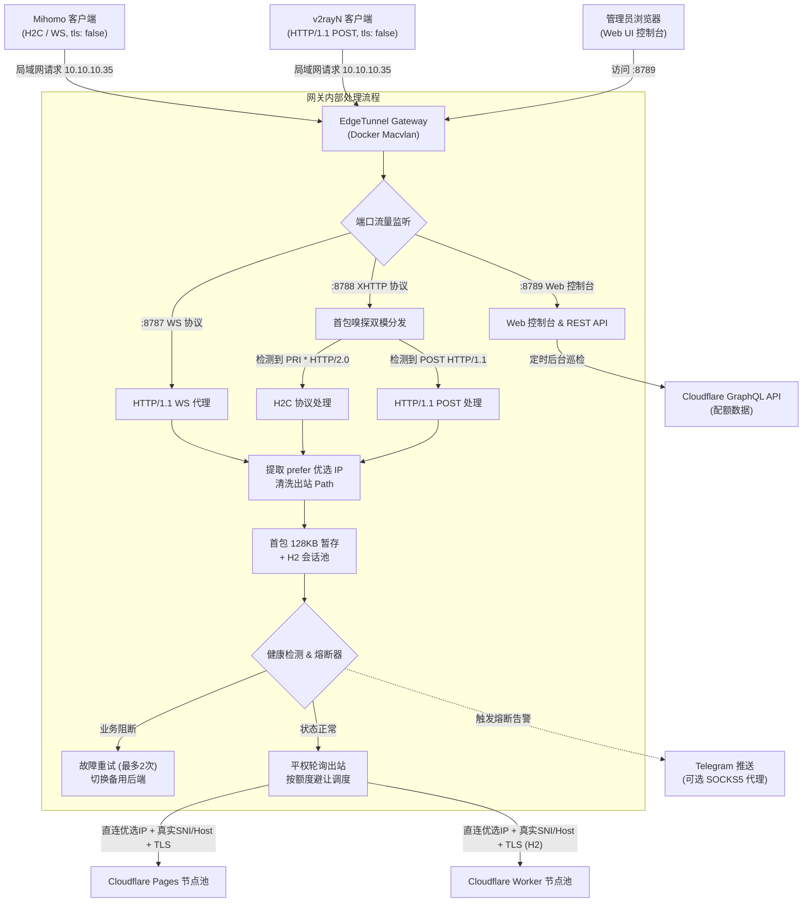

# EdgeTunnel Gateway (edgetunnel-gateway)

[](https://hub.docker.com/_/node)
[](LICENSE)
[]()
[]()
[](https://github.com/aihddelyy/edgetunnel-gateway/wiki)

面向 **Cloudflare Pages / Workers ([EdgeTunnel](https://github.com/cmliu/edgetunnel))** 隧道的局域网分流与负载均衡网关。通常通过 Docker（推荐 Macvlan 独立 IP 模式）部署在群晖 NAS、软路由或 Linux 服务器上，为内网设备（软路由 Mihomo、桌面 v2rayN、手机等）提供出站优选 IP 直连、多后端平权轮询、握手期透明故障转移、协议双模自适应以及 Cloudflare 账户用量监控。

> 详细配置手册、客户端规则转换与疑难排障，可参考 [Wiki 文档中心](https://github.com/aihddelyy/edgetunnel-gateway/wiki)。

---

## 功能特性

- **多协议分流与双模自适应**
  - **端口 `8787` (Pages / WebSocket)**：HTTP/1.1 握手转发，实现 101 Switching Protocols 全双工管道代理。
  - **端口 `8788` (Worker / XHTTP)**：支持首包协议嗅探。通过底层流回放机制，单端口自适应兼容 **Mihomo 原生 H2C (明文 HTTP/2)** 与 **v2rayN (明文 HTTP/1.1 POST 流式)**，客户端无需切换不同端口。
  - **端口 `8789` (Web UI & REST API)**：提供可视化管理面板，支持配置热更新与系统指标监控。
- **握手期透明故障转移 (Failover)**
  - 在握手初期（首包 128KB 以内）如果目标 Cloudflare 节点返回阻断或异常状态码（如 `1101`、`502`、`429`、`403`、`521`）或发生网络中断，网关自动在后台重试备用后端并重放首包数据，客户端连接不会直接断开。
  - **HTTP/2 会话池**：每个出站后端维护独立的 H2 连接池，支持并发多路复用与闲置连接超时回收，减少频繁 TLS 握手开销。
- **平权轮询与额度避让**
  - **平权轮询 (Round-Robin)**：出站连接至同一物理优选节点时，各 Worker 到边缘机房的网络延迟一致，采用平权轮询调度可使各子账户的免费额度（通常 10 万次/天）均匀消耗。
  - **配额超限自动避让**：配合 Cloudflare API 巡检，当某个子账户的使用率达到设定阈值（默认 95%）时，自动暂停向该账户绑定的节点分发流量；全部超限时自动降级兜底运行，避免断网。
- **优选 IP 透传与清洗**
  - 支持客户端在请求路径末尾携带 `prefer=优选IP:端口` 参数（可通过 Sub-Store 脚本自动注入）。
  - 网关在握手阶段提取该参数并直接与目标优选 IP 建立出站连接，同时自动清洗请求路径，保证发往 Cloudflare 端的 Path 规范有效。
  - 自动记录各活跃优选 IP 的延迟与请求次数，支持手动测速和一键设置为全局默认服务器。
- **Cloudflare 账户用量监控**
  - 支持 **Cloudflare 官方 API 直连模式 (Direct)** 与 **[UsagePanel](https://github.com/cmliu/CF-Workers-UsagePanel) 镜像模式**。
  - 后台定时（默认每 5 分钟）静默拉取子账户的 Workers / Pages / KV / D1 / R2 实时用量并在控制台同步显示。
- **健康检查与熔断隔离**
  - 后端连续遭遇 5 次业务阻断错误后自动隔离 60 秒，隔离期满后重新加入可用池。
  - 优选链路丢包或超时归类为网络层异常，不计入 Worker 业务失败，避免误熔断。
- **Telegram 告警通知**
  - 支持节点持续熔断或账户额度超限时推送通知，兼容直连与 SOCKS5 / HTTP 代理通道，内置 15 分钟频控防刷机制。
- **内存控制机制 (Memory Guard)**
  - **握手即清**：首包暂存 Buffer 在远端返回 200 OK 后立即释放，不在长连接中驻留。
  - **背压流控 (Backpressure)**：遵循标准 Stream 流控，远端写缓冲区满时自动暂停读取客户端输入（`pause`），缓冲区排空后恢复（`drain`），防止内存堆积。
  - **连接互锁释放**：任意一端非正常断开时，联动销毁对端 Socket 并清理映射。
  - **后台内存巡检**：运行参数支持 `--expose-gc`，后台定时巡检物理内存（默认 5 分钟），超过设定阈值（默认 150MB）时触发深度清理与垃圾回收。
- **Web 管理控制台**
  - 状态监控：展示各后端节点的转发成功率、额度消耗进度与健康状态。
  - 运维操作：单节点启停开关、优选 IP 列表测速、日志实时查看（SSE）、配置热重载与配置历史快照回滚。

---

## 架构与工作流



---

## 目录结构

项目采用原生 ES Modules (ESM) 与原生前端静态文件结构：

```text
edgetunnel-gateway/
├── server.mjs                  # 入口文件：服务监听装配与 REST API 路由
├── lib/                        # 后端模块
│   ├── config.mjs              # 配置读写、备份与回滚
│   ├── auth.mjs                # 管理员认证与 Session 管理
│   ├── telegram.mjs            # Telegram 消息推送与网络自检
│   ├── health.mjs              # 熔断器、平权轮询与额度调度
│   ├── prefer.mjs              # 活跃优选节点感知与延迟测试
│   ├── traffic.mjs             # 流量历史数据采样与存储
│   ├── cf-quota.mjs            # Cloudflare 配额 API 定时轮询
│   ├── memory.mjs              # 内存监控、GC 与连接清理
│   ├── utils.mjs               # 工具函数
│   ├── proxy-ws.mjs            # WebSocket (8787) Pages 代理
│   └── proxy-xhttp.mjs         # XHTTP (8788) Worker 双模网关与连接池
├── public/                     # 前端静态资源
│   ├── index.html              # 页面结构
│   ├── css/style.css           # 页面样式
│   └── js/app.js               # 控制台逻辑
├── substore-operator.js        # Sub-Store 订阅转换脚本
├── docker-compose.yml          # Docker Compose 编排文件
├── config.json                 # 本地运行时配置文件
└── README.md                   # 说明文档
```

---

## 端口规划

| 端口 | 协议 / 模式 | 用途说明 |
| :---: | :---: | :--- |
| **`8787`** | HTTP/1.1 (WS Upgrade) | Cloudflare Pages (WebSocket) 代理端口 |
| **`8788`** | TCP 首包嗅探 (H2C / H1.1) | Cloudflare Worker (XHTTP) 双模自适应代理端口 |
| **`8789`** | HTTP / REST API | Web UI 管理控制台与监控面板 |

---

## 环境变量说明 (`docker-compose.yml`)

| 环境变量 | 默认值 / 示例 | 说明 |
| :--- | :--- | :--- |
| `PORT` | `8787` | Pages / WebSocket 监听端口 |
| `H2C_PORT` | `8788` | Worker / XHTTP 双模监听端口 |
| `WEB_PORT` | `8789` | Web UI 访问端口 |
| `PREFERRED_SERVER` | `cf.example.com` | 默认兜底优选服务器（客户端未传 `prefer` 时使用） |
| `PAGES_BACKENDS` | `p1.example.com,p2.example.com` | Pages 后端域名列表（英文逗号分隔） |
| `WORKER_BACKENDS` | `w1.example.com,w2.example.com` | Worker 后端域名列表（英文逗号分隔） |
| `TRAFFIC_SAMPLE_MINUTES` | `5` | 流量走势采样间隔（单位：分钟） |
| `CF_PANEL_URL` | `https://usagepanel.pages.dev` | UsagePanel 镜像地址 |
| `TG_BOT_TOKEN` | `123456789:ABC...` | Telegram Bot Token（留空不推送） |
| `TG_CHAT_ID` | `-100123456789` | Telegram Chat ID |
| `TG_PROXY` | `socks5://10.10.10.1:7890` | Telegram 代理（支持 SOCKS5 / HTTP） |
| `MEMORY_THRESHOLD_MB` | `150` | 内存自动回收阈值（单位：MB） |
| `MEMORY_INTERVAL_MINUTES` | `5` | 内存巡检频率（单位：分钟） |

> **说明**：配置除环境变量外，也可直接在 Web 控制台修改并保存至 `config.json`，每次修改会自动备份旧配置。

---

## 部署说明 (群晖 NAS / Linux)

### 1. 准备目录
```bash
mkdir -p /volume2/docker/edgetunnel-lb
cd /volume2/docker/edgetunnel-lb
```
将项目源码放入该目录。推荐使用 `macvlan` 网络赋予容器独立局域网 IP（例如 `10.10.10.35`），避免端口冲突并便于局域网设备统一访问。

### 2. 启动容器
```bash
docker compose up -d
```

### 3. 查看运行日志
```bash
docker compose logs -f
```
正常启动日志输出示例：
```text
============================================================
EdgeTunnel Gateway 已启动
   WebSocket 监听端口: 8787
      Pages 后端列表: p1.example.com, p2.example.com
   XHTTP 监听端口:    8788 (支持 H2C 与 H1.1)
      Worker 后端列表: w1.example.com, w2.example.com
   默认服务器:        cf.example.com
   Web 控制台:        http://0.0.0.0:8789
   内存守护状态:      已启用 (阈值: 150MB, 巡检: 每 5 分钟)
============================================================
```

### 4. 初始化管理员密码
访问 `http://<网关IP>:8789/`，首次打开会提示设置管理员账号与密码，提交后即可登录控制台。

---

## 客户端配置与 Sub-Store 脚本

### 1. Sub-Store 转换脚本
使用仓库内的 `substore-operator.js` 对订阅节点进行自动转换：
1. 打开 Sub-Store 界面；
2. 在目标订阅的 **Script Operator（脚本操作）** 中引入 `substore-operator.js`；
3. 脚本执行以下处理：
   - 提取节点原有的优选服务器地址与端口，转为 `prefer=ip:port` 拼接到 Path 末尾；
   - 将节点服务器地址重定向至网关局域网 IP（如 `10.10.10.35`）；
   - 根据网络类型分流端口：WS 分流至 `8787`，XHTTP 分流至 `8788`；
   - 将节点 `tls` 设置为 `false`，保留原有的 Host、UUID 等认证参数。

### 2. 客户端节点配置示例 (Mihomo)

#### XHTTP 节点 (端口 8788)
```yaml
proxies:
  - name: "[CF] 节点-XHTTP"
    type: vless
    server: 10.10.10.35
    port: 8788
    uuid: 00000000-0000-0000-0000-000000000000
    udp: true
    tls: false              # 直连本地网关，关闭 TLS
    network: xhttp
    xhttp-opts:
      host: lb.example.com
      path: /drama/html/album/proxyip=proxyip.example.com?ed=2560&prefer=cf.example.com
      mode: stream-one
      x-padding-obfs-mode: true
      x-padding-key: your_key
      x-padding-header: your_header
      x-padding-placement: queryInHeader
      x-padding-method: tokenish
    encryption: none
```

#### WebSocket 节点 (端口 8787)
```yaml
proxies:
  - name: "[CF] 节点-WS"
    type: vless
    server: 10.10.10.35
    port: 8787
    uuid: 00000000-0000-0000-0000-000000000000
    udp: true
    tls: false              # 直连本地网关，关闭 TLS
    network: ws
    ws-opts:
      path: /redirect.html/about/library/proxyip=104.16.1.1:443?prefer=104.16.1.1:443
      headers:
        Host: pglb.example.com
    encryption: none
```

---

## 常见问题 (FAQ)

### Q1: 客户端配置中为什么必须将 TLS 设为 `false`？
客户端直接连接的是局域网内的网关（如 `10.10.10.35`），内网环境无法也不需要进行公网证书握手。真正的 TLS 加密建立在**网关到 Cloudflare 边缘服务器的出站链路**上，由网关携带真实的后端域名（SNI 与 Host）建立 TLS 1.3 / H2 加密。

### Q2: 遇到节点被 Cloudflare 阻断时，客户端会断连吗？
不会。网关内置首包 128KB 内存缓冲机制。在握手阶段，若远端返回 `1101`、`502`、`429`、`521` 等业务阻断状态码，网关会在后台切换至备用 Worker/Pages 节点并重放首包，过程对客户端透明。

### Q3: 为什么 v2rayN 与 Mihomo 可以共用 8788 端口？
Xray-core (v2rayN) 在未开启 TLS 时使用 HTTP/1.1 POST 进行流式传输，而 Mihomo 在明文模式下发送 RFC 7540 标准的 H2C 握手前言（`PRI * HTTP/2.0...`）。网关在端口 `8788` 入口进行首包字节匹配，分别转交给内置的 H2C 或 HTTP/1.1 解析器，无需分设不同端口。

### Q4: Cloudflare 额度自动避让逻辑是怎样的？
默认阈值为 95%。当某个子账户当天的请求数消耗达到阈值时，网关在调度时会自动将该账户绑定的节点移出可用池，优先使用其余未超限账户。若所有账户均达到阈值，网关会自动降级保留全部节点继续轮询，避免断网。该阈值可在控制台“核心配置”中调整（10% ~ 100%）。

### Q5: 大流量下载或长期运行下，网关内存表现如何？
网关采用以下机制控制内存开销：
1. **握手即释放**：首包 128KB 暂存在收到远端 200 OK 后立即清空，不驻留内存；
2. **背压流控**：严格按照 Node.js Stream 规范，写入缓冲区满时自动挂起输入流，排空后恢复；
3. **连接联动清理**：客户端或服务端任一端断开时，联动销毁对端 Socket 并清理内部状态；
4. **定时 GC 巡检**：容器启动带 `--expose-gc` 参数时，后台每 5 分钟巡检一次，超过安全阈值（默认 150MB）时自动触发全局清理与 V8 垃圾回收，常驻内存通常维持在 50~80MB。

---

## 鸣谢

- **[cmliu/edgetunnel](https://github.com/cmliu/edgetunnel)**：提供 Cloudflare Workers / Pages 边缘隧道核心逻辑。
- **[cmliu/CF-Workers-UsagePanel](https://github.com/cmliu/CF-Workers-UsagePanel)**：提供 Cloudflare 多账户配额展示面板支持。

---

## 许可证

本项目基于 [MIT 许可证](LICENSE) 开源。