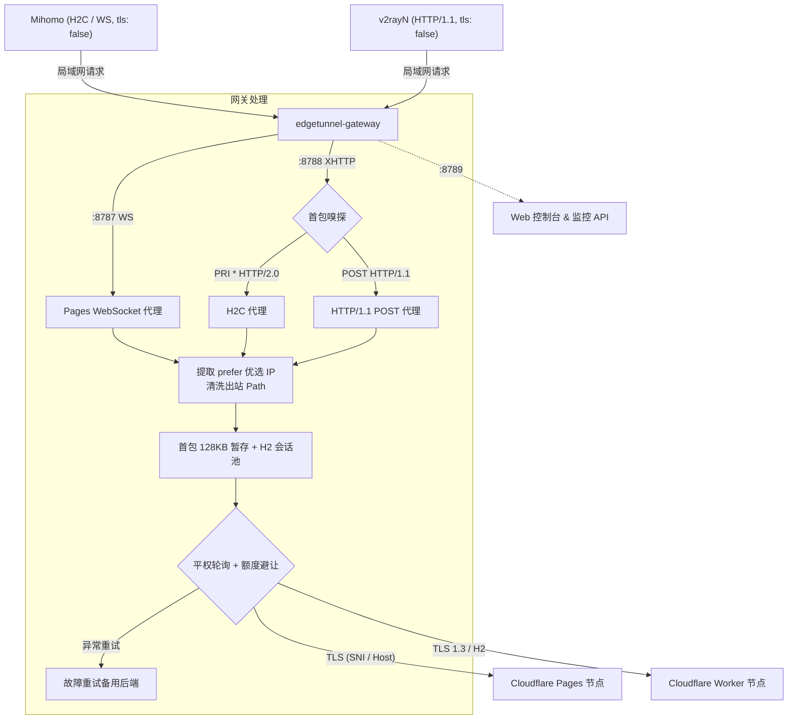

# edgetunnel-gateway

edgetunnel-gateway 是面向 Cloudflare Workers / Pages ([EdgeTunnel](https://github.com/cmliu/edgetunnel)) 的本地分流与负载均衡网关。通常以 Docker 容器形式部署在局域网（软路由、群晖 NAS 或 Linux 主机），为内网客户端（Mihomo、v2rayN 等）提供优选 IP 出站直连、多节点平权轮询、握手期透明故障转移与用量监控。

完整使用文档与技术细节见 [GitHub Wiki](https://github.com/aihddelyy/edgetunnel-gateway/wiki)。

---

## 核心特性

- **协议分流与双模嗅探**
  - `8787`：处理 HTTP/1.1 握手与 WebSocket 全双工流（面向 Pages）。
  - `8788`：首包协议嗅探。单端口自适应兼容 Mihomo 的明文 HTTP/2 (H2C) 与 v2rayN 的 HTTP/1.1 POST 流式请求。
  - `8789`：Web 管理控制台与 REST API。
- **优选 IP 透传**：解析请求 Path 中的 `prefer=IP:Port` 参数直连目标 Cloudflare 边缘节点，并在出站请求中自动清理该参数。
- **平权轮询与故障转移**：出站请求按 Round-Robin 均衡分发到各后端；若首包（128KB 暂存区内）收到 1101/502/429 等错误或连接异常，自动换线重试，客户端无感。
- **配额监控与避让**：支持 Cloudflare 官方 API 直连或 UsagePanel 镜像，按子账户额度消耗自动移出超限节点。
- **流控与内存管理**：连接握手成功后立即释放暂存 Buffer；基于 Node.js Stream 标准背压转发；支持定时内存巡检与垃圾回收（`--expose-gc`）。

---

## 架构示意



---

## 端口与环境变量

### 端口映射

| 端口 | 协议 | 说明 |
| :---: | :---: | :--- |
| `8787` | HTTP/1.1 (WS) | Pages (WebSocket) 代理端口 |
| `8788` | TCP 嗅探 (H2C / H1.1) | Worker (XHTTP) 双模代理端口 |
| `8789` | HTTP | Web 控制台与管理 API |

### 常用环境变量

| 变量名 | 默认值 | 说明 |
| :--- | :--- | :--- |
| `PORT` | `8787` | Pages / WebSocket 监听端口 |
| `H2C_PORT` | `8788` | Worker / XHTTP 监听端口 |
| `WEB_PORT` | `8789` | Web 管理面板端口 |
| `PREFERRED_SERVER` | `cf.example.com` | 兜底优选服务器（客户端未指定 `prefer` 时使用） |
| `PAGES_BACKENDS` | - | Pages 域名列表（逗号分隔） |
| `WORKER_BACKENDS` | - | Worker 域名列表（逗号分隔） |
| `CF_PANEL_URL` | - | UsagePanel 镜像地址（用于额度监控） |
| `TG_BOT_TOKEN` | - | Telegram Bot Token（用于告警推送） |
| `TG_CHAT_ID` | - | Telegram Chat ID |
| `TG_PROXY` | - | Telegram 代理（如 `socks5://10.10.10.1:7890`） |
| `MEMORY_THRESHOLD_MB` | `150` | 内存自动回收阈值（MB） |

---

## 快速部署

推荐使用 Docker Macvlan 模式分配独立内网 IP，避免宿主机端口冲突。

### 1. 编写 `docker-compose.yml`

```yaml
version: "3.8"

services:
  edgetunnel-lb:
    image: node:20-alpine
    container_name: edgetunnel-lb
    restart: always
    working_dir: /app
    volumes:
      - ./:/app
    environment:
      - NODE_ENV=production
      - PORT=8787
      - H2C_PORT=8788
      - WEB_PORT=8789
      - PREFERRED_SERVER=cf.example.com
      - PAGES_BACKENDS=p1.example.com,p2.example.com
      - WORKER_BACKENDS=w1.example.com,w2.example.com
    command: ["node", "--expose-gc", "server.mjs"]
    networks:
      macvlan_net:
        ipv4_address: 10.10.10.35

networks:
  macvlan_net:
    external: true
```

### 2. 启动服务

```bash
docker compose up -d
docker compose logs -f
```

启动后访问 `http://<网关IP>:8789` 初始化管理员密码并进入控制台。

---

## 客户端配置

### 注意事项

客户端直连本地网关，**必须将节点的 `tls` 设为 `false`**。由网关使用真实 Host / SNI 与 Cloudflare 边缘服务器建立公网 TLS / H2 安全连接。

### Mihomo 配置示例

#### XHTTP 节点 (端口 8788)
```yaml
proxies:
  - name: "CF-Worker-XHTTP"
    type: vless
    server: 10.10.10.35
    port: 8788
    uuid: 00000000-0000-0000-0000-000000000000
    udp: true
    tls: false
    network: xhttp
    xhttp-opts:
      host: worker.example.com
      path: /drama/html/album/proxyip=proxyip.example.com?ed=2560&prefer=cf.example.com
      mode: stream-one
```

#### WebSocket 节点 (端口 8787)
```yaml
proxies:
  - name: "CF-Pages-WS"
    type: vless
    server: 10.10.10.35
    port: 8787
    uuid: 00000000-0000-0000-0000-000000000000
    udp: true
    tls: false
    network: ws
    ws-opts:
      path: /redirect.html/about/library/proxyip=104.16.1.1:443?prefer=104.16.1.1:443
      headers:
        Host: pages.example.com
```

### 自动转换 (Sub-Store)

可在 Sub-Store 中使用仓库自带的 [`substore-operator.js`](substore-operator.js) 脚本，自动将订阅节点转换为指向网关内网 IP、注入 `prefer` 参数并按协议分流至对应端口。

---

## 详细文档

更多部署排障、快照回滚、Macvlan 混杂模式与内存治理机制，详见 Wiki：

- [01. 快速上手指南](https://github.com/aihddelyy/edgetunnel-gateway/wiki/01-快速上手指南-Quick-Start)
- [02. 核心架构与工作原理](https://github.com/aihddelyy/edgetunnel-gateway/wiki/02-核心架构与工作原理-Architecture-&-Mechanisms)
- [03. 全量配置参数详解](https://github.com/aihddelyy/edgetunnel-gateway/wiki/03-全量配置参数详解-Configuration-Guide)
- [04. 客户端接入与 Sub-Store 指南](https://github.com/aihddelyy/edgetunnel-gateway/wiki/04-客户端接入与-Sub-Store-指南-Client-Integration)
- [05. Cloudflare 额度监控与联动](https://github.com/aihddelyy/edgetunnel-gateway/wiki/05-Cloudflare-额度监控与联动-Cloudflare-Quota-Monitoring)
- [06. 内存治理与性能调优](https://github.com/aihddelyy/edgetunnel-gateway/wiki/06-内存治理与性能调优-Memory-Guard-&-Performance)
- [07. 常见问题与故障排查](https://github.com/aihddelyy/edgetunnel-gateway/wiki/07-常见问题与故障排查-FAQ-&-Troubleshooting)

---

## 许可证

[MIT License](LICENSE)