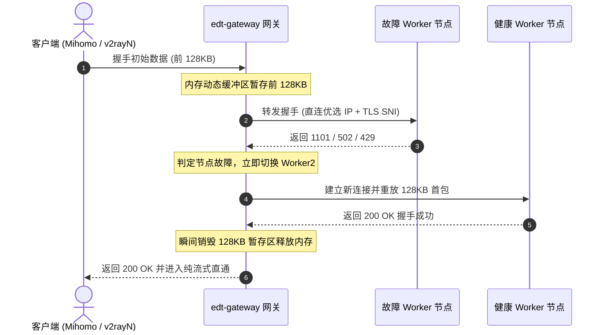

# 02. 核心架构与工作原理 (Architecture & Mechanisms)

**edgetunnel-gateway** 采用纯 Go 语言重构，依托 Go 原生出色的网络多路复用与高并发并发模型（Goroutine），实现了零外部依赖的软路由级企业网关。

---

## 一、 独立端口与双模自适应协议嗅探

网关将流量拆分为不同物理端口监听：
- **`8787` 端口**：处理 WebSocket Upgrade 双向全双工管道（Pages 节点专属）。
- **`8788` 端口**：Worker 节点专属，具备**首包零损耗协议嗅探双模自适应**能力。

### 嗅探机制详解
不同代理客户端在明文出站时遵循不同标准：
- **Mihomo (Clash Meta)** 在未启用 TLS 时发送 RFC 7540 标准的明文 H2C 前言（24 字节魔数：`PRI * HTTP/2.0\r\n\r\nSM\r\n\r\n`）。
- **v2rayN (Xray-core)** 在 `security: none` 时使用 HTTP/1.1 POST 流式分块传输。

网关在 8788 端口通过 Go 原生 `net.Listener` 拦截首包前 24 字节：
1. 若命中 H2C 前言魔数，直接无缝移交给内置的 HTTP/2 协议栈；
2. 若未命中，则判定为标准 HTTP/1.1 POST 数据流；
3. 嗅探逻辑纯内存完成，客户端完全无感，无需为不同软件分别开辟不同端口。

---

## 二、 128KB 动态首包暂存与毫秒级故障转移 (Failover)

当直连出站访问 Cloudflare 边缘节点时，边缘可能偶发冷启动抖动或返回异常状态码（如 `1101` 脚本崩溃、`502 Bad Gateway`、`429 Too Many Requests`、`521 Web Server Is Down`）。

- **零断流**：故障切换在内部毫秒级完成，客户端完全无感知。
- **即时销毁**：远端一旦响应 200 OK，暂存缓冲区立即清空解绑，绝不占用长连接常驻内存。

---

## 三、 全链路零损耗字节级流量统计与采样 (`pkg/traffic`)

网关在双向转发流中挂载了基于 `sync/atomic` 的零损耗原子计数器：
- **精准度**：在 TCP/TLS 数据传输流水线中精确截获真实上传与下载字节数；
- **滑动采样**：内置 1 秒级时间窗口平滑采样器，实时计算出平稳、真实的瞬时下行带宽（Download Speed）与上行带宽（Upload Speed）；
- **零开销**：无锁原子操作，单核性能损耗小于 0.01%，万兆吞吐毫无压力。

---

## 四、 活跃优选服务器 (Prefer Nodes) 稳定排序机制 (规则 A)

为避免控制台刷新或轮询时“优选服务器卡片”位置上下跳动，网关引入了严格的**规则 A 稳定三级排序**：
1. **默认兜底节点置顶**：配置文件中指定的全局兜底优选 IP 永远稳坐第 1 位展示；
2. **业务请求量降序**：客户端真实请求量（`requestCount`）从大到小依次排序，最活跃、分流最多的节点始终靠前；
3. **节点名称字典序保底**：当请求量相同时，按优选服务器名称字典序固定排列。

---

## 五、 Anti-FakeIP 穿透 DNS 纯净拨号引擎

针对在 OpenWrt 软路由上将 `edt-gateway` 与 Mihomo (Clash) 部署在同一主机，且 Mihomo 运行在 Fake-IP 模式时的网络黑洞问题：
1. 网关识别 `198.18.0.0/15`（RFC 2544 基准测试保留段）；
2. 当网关执行更新、探测或直连出站时，若本地 DNS 返回了 Fake-IP 或解析失败，底层自动启用专属公共纯净 DNS（阿里 `223.5.5.5`、腾讯 `119.29.29.29`、Cloudflare `1.1.1.1`）进行 UDP 穿透解析；
3. 确保直连放行流量永远拿到真实公网 IP，彻底杜绝数据包被物理 WAN 口抛弃的致命黑洞。
