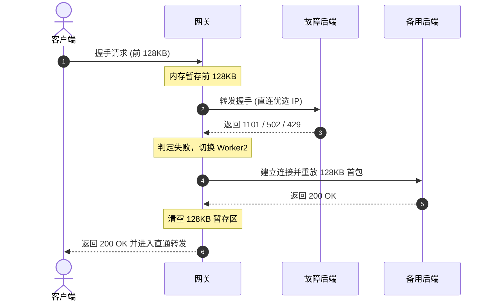

# 架构与工作原理

## 端口规划

网关通过独立物理端口隔离协议与管理面，避免握手协商额外开销：

- `8787`：Pages 专属，处理 HTTP/1.1 WebSocket Upgrade 全双工数据流。
- `8788`：Worker 专属，TCP 首包嗅探双模自适应（H2C 与 HTTP/1.1 POST）。
- `8789`：Web 控制台与 REST API。

---

## 8788 端口双模自适应

### 背景

- **Mihomo (Clash Meta)** 在未配置 TLS 时发送 RFC 7540 明文 H2C 前言（`PRI * HTTP/2.0\r\n\r\nSM\r\n\r\n`）。
- **v2rayN (Xray-core)** 在 `security: none` 时使用 HTTP/1.1 POST 流式分块传输。

### 嗅探机制

网关在 8788 端口统一监听 TCP：
1. 拦截客户端首包前 24 字节；
2. 匹配魔数 `PRI * HTTP/2.0\r\n\r\nSM\r\n\r\n`，命中则分发至内置 H2C 解析器，否则分发至内置 HTTP/1.1 解析器；
3. 将拦截的字节通过 `unshift` 写回 Socket 并交由目标协议栈处理。整个嗅探过程在内存中完成，无多余代理转发层。

---

## 128KB 暂存与故障转移 (Failover)

直连 Cloudflare 边缘节点时，可能遇到节点冷启动或实例故障返回 `1101`、`502`、`429`、`521`。

- **重试上限**：单次握手最多自动重试 2 次。
- **内存回收**：收到远端 200 OK 后立即清空暂存数组，转入纯流式传输，不占用常驻内存。

---

## 调度机制：平权轮询 (Round-Robin)

不同于常规根据延迟动态加权的代理网关，本项目使用平权轮询：

1. **物理延迟一致**：客户端出站直连相同的优选 IP 时，各 Worker 域名到 Cloudflare 边缘机房的物理网络延迟完全一致，短时延迟波动不代表节点性能。
2. **配额均匀消耗**：动态测速加权容易导致部分节点被过量分流，使其每日 10 万次免费配额提前耗尽。平权轮询能使多子账户配额平稳消耗。
3. **配额避让**：结合后台定时拉取的配额数据，当某子账户用量达到阈值（默认 95%）时，该账户对应节点自动暂停调度；所有账户超限时自动降级继续提供服务。

---

## 出站路径清洗与伪装

1. 从客户端请求 Path 中提取 `prefer=IP:Port` 参数；
2. 移除 `prefer` 参数，恢复后端 Workers/Pages 脚本原始 Path；
3. 直接与提取出的优选 IP 建立出站 TCP 连接；
4. 将 TLS SNI 与 HTTP Host 请求头设置为当前轮询到的 Worker/Pages 真实域名，完成公网 TLS 1.3 / H2 加密出站。
