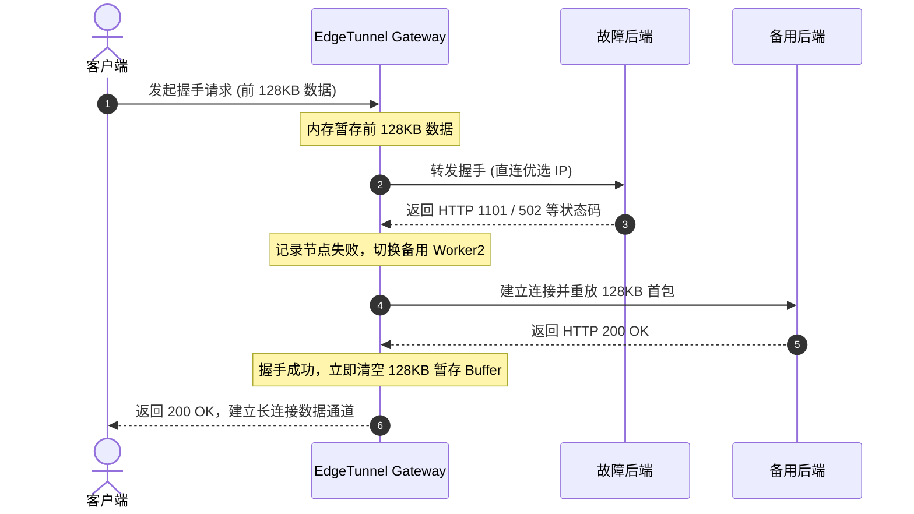

# 架构与工作原理 (Architecture & Mechanisms)

本文档详细说明 **EdgeTunnel Gateway** 的底层架构、协议嗅探流程、故障转移机制与出站调度策略。

---

## 1. 技术选型与运行模型

网关基于 **Node.js 20 ESM (ECMAScript Modules)** 构建，采用事件驱动与异步非阻塞 I/O 架构：

| 考量维度 | 说明 |
| :--- | :--- |
| **I/O 模型** | 基于底层 `libuv` 事件循环，单线程异步处理高并发流转发，资源占用低。 |
| **协议栈支持** | 原生内置标准 `http`、`http2`、`net` 与 `tls` 模块，无需额外编译 C/C++ 扩展即可直接操作 TCP 与 HTTP/2 帧。 |
| **热更新能力** | 源码通过挂载运行，修改后可通过指令毫秒级平滑重启，免去繁琐的镜像重构。 |
| **系统资源** | 在常规千兆并发吞吐下，常驻物理内存约 50MB~80MB，CPU 占用率低于 2%。 |

---

## 2. 独立端口分流设计

网关通过监听不同物理端口隔离业务流量与管理流量，避免运行时协议层反复协商带来的开销：

```text
       ┌── 端口 8787: Pages 专属 (HTTP/1.1 WebSocket Upgrade 全双工管道)
入站流量 ├── 端口 8788: Worker 专属 (TCP 首包嗅探双模自适应: H2C 与 HTTP/1.1 POST)
       └── 端口 8789: Web UI 管理控制台与 REST API (管理面)
```

---

## 3. 首包协议嗅探与双模自适应 (端口 8788)

### 需求背景
- **Mihomo (Clash Meta)** 在未配置 TLS 时，遵循 RFC 7540 标准发送明文 H2C 前言（`PRI * HTTP/2.0\r\n\r\nSM\r\n\r\n`）；
- **v2rayN (Xray-core)** 在 `security: none` 时，XHTTP 协议使用明文 `HTTP/1.1 POST` 进行流式分块传输；
- 若网关单端口仅支持单一协议，客户端切换时需频繁更换端口。

### 工作流程
网关在 `8788` 端口监听 TCP 连接，通过 Node.js 原生底层流回放机制实现协议自适应分流：
1. 客户端建立连接后，网关拦截首包前 24 字节；
2. **字节匹配**：
   - 若匹配到 H2C 魔数（`PRI * HTTP/2.0\r\n\r\nSM\r\n\r\n`），判定为 **H2C 协议**，转交内置的 HTTP/2 服务器处理；
   - 否则判定为 **HTTP/1.1 请求**，转交内置的 HTTP/1.1 服务器处理；
3. 将首包写回底层 Socket 并转入双向 Stream 管道，整个探测过程在内存中完成，无协议转发损耗。

---

## 4. 首包 128KB 暂存与透明故障转移 (Failover)

直连 Cloudflare 边缘节点时，偶发因机房调度或实例冷启动返回 `1101`（Worker 脚本执行异常）、`502`、`429`（限流）或 `521`：



- **客户端透明**：握手阶段的重试在网关内部完成（最多重试 2 次），客户端无需重连；
- **内存回收**：一旦收到 200 OK，网关立即清空暂存数组（`initialChunks.length = 0`），数据流转为流式直通，不长期占用内存。

---

## 5. HTTP/2 连接池管理

对于 XHTTP 协议，多个请求流在底层 HTTP/2 连接中复用：
- 网关为每个目标后端建立独立的 H2 连接池；
- 当连接流数较高时弹性新建会话，避免所有流挤在单条 TCP 连接中引发队头阻塞；
- 空闲连接超过 60 秒自动断开并移出连接池，降低连接闲置开销。

---

## 6. 调度策略考量：平权轮询 (Round-Robin)

部分负载均衡网关采用 EWMA（指数加权移动平均）按测速延迟动态分配权重。本项目针对 Cloudflare 架构特点，选择**平权轮询**：

1. **物理延迟一致性**：
   - 客户端出站直连同一个优选 IP 时，所有 Worker 域名最终抵达 Cloudflare 边缘机房的物理网络路径和 RTT 几乎一致；
   - 本地偶发的延迟抖动并非 Worker 性能差异。
2. **避免配额倾斜**：
   - 若根据短时延迟打分加权，可能导致个别节点分流比例过高，导致该子账户每日的免费配额（10 万次）提前用尽，而其余账户配额闲置；
3. **平权与配额避让结合**：
   - 采用平权轮询均匀分发请求；
   - 结合后台 Cloudflare API 巡检，当某个子账户消耗超过设定阈值（默认 95%）时，自动将其移出可用池，实现多账户平滑轮换。

---

## 7. 出站 SNI / Host 伪装与 Path 清洗

客户端发来请求后的出站处理流水线：
1. **提取参数**：从请求路径中解析 `prefer=优选IP:端口`；
2. **清洗 Path**：使用正则移除 `prefer=...` 参数及其附带的连接符，还原后端 Worker / Pages 脚本要求的原始路径；
3. **物理连接**：网关向解析出的优选 IP 与端口发起真实 TCP 连接；
4. **TLS 握手**：将 TLS SNI 与 HTTP Host 请求头重写为被轮询到的真实 Worker / Pages 域名，完成出站加密转发。
