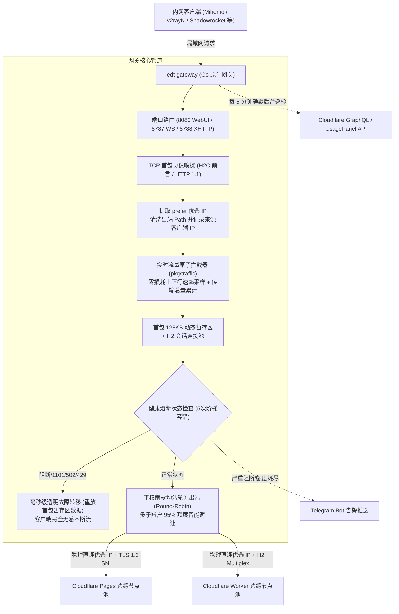

# 📚 EdgeTunnel Gateway 官方 Wiki 首页

**edgetunnel-gateway** 是一款专为 Cloudflare Workers / Pages 边缘节点 ([EdgeTunnel](https://github.com/cmliu/edgetunnel)) 设计的**高性能、高并发、企业级轻量负载均衡网关**。

本项目已全面完成 **Go 语言原生重构 (Zero-dependency Single Binary)**，彻底告别旧时代的 Node.js 运行时与 V8 引擎，静态编译为纯净独立二进制，内存占用由原先的 80MB+ 骤降至 **15MB**，极度适合软路由（OpenWrt）、轻量 VPS、NAS（群晖/绿联/极空间）与 Linux 宿主机原生部署。

---

## 🌟 核心特性全景

* 🚀 **极度轻量与超高性能**：采用 Go 原生并发 Goroutine 与全异步流式管道，CPU 占用趋近于零，内存常驻仅 15MB。
* 🌐 **优选 IP 透传与物理直连**：客户端在 URL 中指定 `prefer=优选IP:端口`，网关在物理层直连指定边缘机房，出站自动绑定后端域名完成公网 TLS 1.3 / H2 加密。
* 🔀 **平权均摊轮询调度 (Fair Round-Robin)**：多节点严格均匀分流，配合 Cloudflare GraphQL 额度监控，支持 95% 免费额度智能熔断避让。
* 🔄 **双模协议嗅探自适应 (端口 8788)**：单端口自适应匹配 Mihomo (RFC 7540 明文 H2C 前言) 与 v2rayN (HTTP/1.1 POST)，客户端无感即插即用。
* 🛡️ **128KB 首包暂存与透明故障转移 (Failover)**：握手失败或遇 `1101/502/429` 错误时，0 毫秒级重放首包切至健康节点，连接完全不断流。
* 📊 **全链路零损耗字节级流量监控**：内置 `pkg/traffic` 纳秒级原子采样器，实时展示上下行瞬时速率与累计传输总量。
* 🎯 **活跃优选服务器稳定排序 (规则 A)**：默认兜底置顶 + 请求量从大到小排列 + 字典序保底，彻底消除控制台卡片跳动。
* 🛡️ **Anti-FakeIP 穿透 DNS 纯净拨号**：与同机部署的 Mihomo (Clash) Fake-IP 模式完美共存，内置公共纯净 DNS 解析，杜绝公网黑洞丢包。
* 🚀 **现代 Web 控制台与原子平滑自更新**：支持在线一键重启，支持内置镜像与用户自定义加速镜像多通道容灾更新。

---

## 🏛️ 系统架构图

---

## 📖 Wiki 知识库目录

- [01. 快速上手指南 (Quick Start)](01-快速上手指南-Quick-Start)：OpenWrt 一键脚本安装、Linux/NAS 原生部署、系统服务与在线升级。
- [02. 核心架构与工作原理 (Architecture & Mechanisms)](02-核心架构与工作原理-Architecture-&-Mechanisms)：Go 并发流式管道、H2C/H1.1 首包嗅探、128KB 暂存故障转移、流量统计与稳定排序。
- [03. 全量配置参数详解 (Configuration Guide)](03-全量配置参数详解-Configuration-Guide)：`config.json` 规范、控制台各项调度参数、自动快照备份与回滚。
- [04. 客户端接入与 Sub-Store 指南 (Client Integration)](04-客户端接入与-Sub-Store-指南-Client-Integration)：Mihomo / v2rayN 节点示例配置与 Sub-Store 动态优选脚本。
- [05. Cloudflare 额度监控与联动 (Cloudflare Quota Monitoring)](05-Cloudflare-额度监控与联动-Cloudflare-Quota-Monitoring)：GraphQL 官方直连、UsagePanel 镜像与 95% 额度熔断避让。
- [06. 内存治理与高性能调优 (Memory & Performance)](06-内存治理与性能调优-Memory-Guard-&-Performance)：彻底告别 Node.js V8 束缚，深入了解 Go 运行时高效内存管理与并发连接调优。
- [07. 常见问题与故障排查 (FAQ & Troubleshooting)](07-常见问题与故障排查-FAQ-&-Troubleshooting)：同机部署 Mihomo Fake-IP 冲突排查、`tls: false` 内外网原理解析、业务熔断与物理网络排障。
