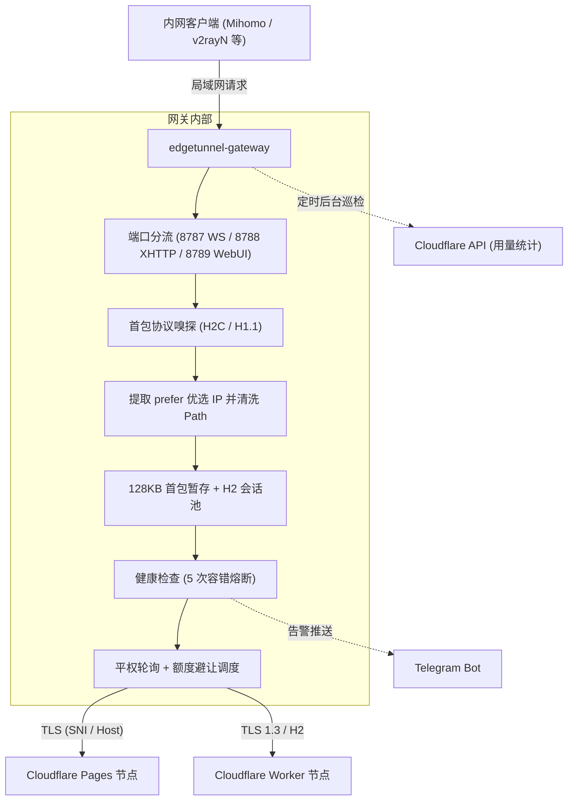

# Wiki 首页

edgetunnel-gateway 是针对 Cloudflare Workers / Pages ([EdgeTunnel](https://github.com/cmliu/edgetunnel)) 的内网分流与负载均衡网关。通常部署在局域网（软路由、群晖 NAS 或 Linux 主机），处理优选 IP 透传、平权轮询出站、协议自适应及配额避让。

---

## 架构

---

## 文档目录

- [01. 快速上手](01-快速上手指南-Quick-Start)：Docker Compose 部署、Macvlan 独立 IP 与网卡混杂模式配置。
- [02. 架构与原理](02-核心架构与工作原理-Architecture-&-Mechanisms)：H2C 与 HTTP/1.1 首包嗅探、128KB 暂存故障转移、连接池与平权轮询。
- [03. 配置参数](03-全量配置参数详解-Configuration-Guide)：环境变量、控制台配置项与历史配置回滚。
- [04. 客户端接入](04-客户端接入与-Sub-Store-指南-Client-Integration)：Mihomo / v2rayN 节点示例与 Sub-Store 脚本。
- [05. 额度监控](05-Cloudflare-额度监控与联动-Cloudflare-Quota-Monitoring)：Cloudflare 官方 API 直连与 UsagePanel 镜像配置。
- [06. 内存治理](06-内存治理与性能调优-Memory-Guard-&-Performance)：握手释放、Stream 背压与 Node.js V8 GC 机制。
- [07. 故障排查](07-常见问题与故障排查-FAQ-&-Troubleshooting)：常见报错、优选链路与业务阻断隔离、Macvlan 无法通信排查。
