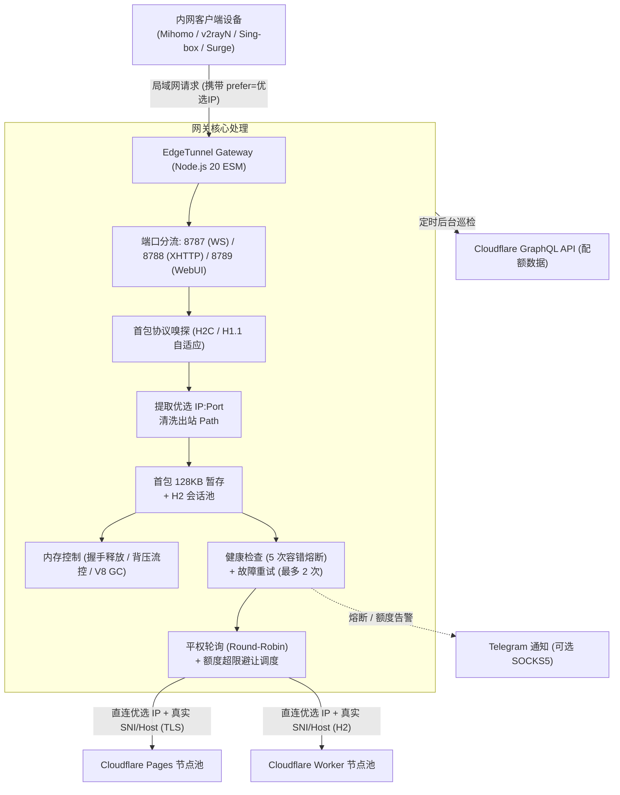

# EdgeTunnel Gateway 文档指南

欢迎查阅 **EdgeTunnel Gateway** 文档。

本项目面向 **Cloudflare Pages / Workers ([EdgeTunnel](https://github.com/cmliu/edgetunnel))** 隧道生态，是一款运行于本地局域网（群晖 NAS、软路由或 Linux 服务器）的分流与负载均衡网关，负责为内网客户端提供出站直连优选 IP、多域名平权轮询、握手期透明故障转移与 Cloudflare 账户额度监控。

---

## 架构总览

---

## 文档目录

文档按使用场景划分为 7 个章节：

| 章节 | 文档说明 | 核心内容 |
| :--- | :--- | :--- |
| **[01. 快速上手指南](01-快速上手指南-Quick-Start)** | 基础安装部署 | 群晖 NAS Container Manager、Linux Docker Compose 部署、Macvlan 独立网络配置与网卡混杂模式设置。 |
| **[02. 核心架构与原理解析](02-核心架构与工作原理-Architecture-&-Mechanisms)** | 架构机理说明 | 首包双模嗅探原理 (H2C 与 H1.1 POST)、128KB 暂存透明重试、H2 会话池调度与平权轮询设计考量。 |
| **[03. 全量配置参数手册](03-全量配置参数详解-Configuration-Guide)** | 配置参数参考 | 环境变量清单、Web 控制台配置项说明、额度避让阈值与配置历史快照备份回滚机制。 |
| **[04. 客户端接入与 Sub-Store 指南](04-客户端接入与-Sub-Store-指南-Client-Integration)** | 客户端配置与转换 | Sub-Store 节点重定向脚本说明，Mihomo (Clash Meta)、v2rayN、Sing-box 等客户端配置模板。 |
| **[05. Cloudflare 额度监控与联动](05-Cloudflare-额度监控与联动-Cloudflare-Quota-Monitoring)** | 账户用量监控 | Cloudflare 官方 API 直连模式与 UsagePanel 镜像模式配置流程、GraphQL Token 权限配置与告警设置。 |
| **[06. 内存治理与性能调优](06-内存治理与性能调优-Memory-Guard-&-Performance)** | 资源开销与流控 | 握手释放机制、Stream 全链路背压、连接联动销毁与 V8 原生垃圾回收 (`--expose-gc`) 配置。 |
| **[07. 常见问题与故障排查](07-常见问题与故障排查-FAQ-&-Troubleshooting)** | 疑难解答与排障 | 客户端为什么关闭 TLS、1101/502 错误排查、优选 IP 测速原理与 Macvlan 通信隔离解决方案。 |

---

## 设计原则

1. **出站平权轮询**：
   - 客户端出站直连同一个物理优选 IP 时，所有 Worker 抵达 Cloudflare 边缘机房的物理网络 RTT 一致；
   - 采用平权轮询 (Round-Robin)，使各子账户的免费配额（通常 10 万次/天）均匀消耗，避免单一节点因偶发测速波动被分配过多流量导致配额过早耗尽。
2. **分层错误处理**：
   - **优选链路故障**（超时、丢包、连接拒绝）：属于链路层异常，网关快速返回或关闭，由客户端策略组自动切流；
   - **Cloudflare 业务阻断**（1101 脚本崩溃、429 超额、502 错误）：物理连接通畅，网关在后台利用 128KB 首包暂存切换至备用 Worker 重试。
3. **轻量与透明**：
   - 全流程采用 Node.js 20 ESM 原生代码与前端静态资源，无构建依赖，改动直接生效。
